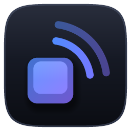

<p align="center">
  
</p>

<h1 align="center">Clickwave</h1>

<p align="center"><b>Clean, real-time click sounds for your keyboard and mouse - built for gamers and streamers.</b><br>
Windows 10/11 · free · no install</p>

---

## Why it exists

Streamers run noise suppression (NVIDIA Broadcast, RNNoise, noise gates) so their voice sounds clean - and those
filters erase key clicks, because a click is exactly the kind of sharp noise they're designed to remove. Turning the
filters off makes your mic sound bad.

Clickwave plays a click the instant you press a key, on its own clean audio path that OBS captures straight from Clickwave (or through a virtual cable), so
viewers hear your clicks again without your mic ever being involved.

## Features

**Clicks that feel real**
- ~10 ms engine latency (WASAPI device period), every click its own voice so spam never stutters
- Only the keys / mouse buttons you choose make sound - held keys don't repeat
- **Spam dynamics** - fast taps automatically play softer clicks, like a real switch (uses the pack's soft clicks or generates them)
- Release clicks, pitch variation, humanize, per-input pack / level / stereo pan (P1 left, P2 right)

**Built for streaming**
- **Stream routing:** the default is OBS *Application Audio Capture* of Clickwave.exe, so no virtual cable is needed. Virtual-cable routing (VB-CABLE / Voicemeeter auto-detected, separate outputs and levels for *you* and *the stream*) is still there under *Settings > Audio output* for setups that need it
- "Mute myself" hotkey (virtual-cable routing only: the stream keeps hearing clicks while you don't)
- **Stream overlay** - a live input display + CPS counter as an OBS Browser source, with a built-in designer: drag keys into any layout, rename or widen them, pick sizes and colors, choose which stats show and where. Changes appear in OBS instantly and it stays sharp at any size
- Test button per output device to confirm OBS hears it

**Any sound you want**
- **Record your own keyboard** - Clickwave finds every click in the recording, separates press and release, and lets you fine-tune or hand-edit every clip
- Import **GD clickpacks** (`player1/clicks, softclicks, releases...`), **Mechvibes packs**, or plain audio files (WAV, MP3, OGG, M4A, FLAC, WMA, video)
- Pack editor, export / share packs as `.zip`

**Stays out of your way**
- In-game hotkeys with Ctrl/Shift/Alt combos (start/stop, volume, next profile, mute)
- Profiles per game, "only click in these apps", tray mode, launch with Windows
- CPS test, live stats, light/dark themes and accent colors

## Fair play

Clickwave is built to make it hard to fake a run by accident or on purpose:

- **Software-simulated input is ignored** (macros, bots, AutoHotkey, `SendInput`): no sound, no overlay key,
  no CPS. Hardware macro pads that send real key presses work normally.
- **No delay is possible.** There's no offset setting, and silence before a clip's attack is trimmed when a pack
  loads, so a pack can't hide a delay in its own files. (The sound then takes the audio engine's ~10 ms, see below.)
- **Previews never reach the stream.** Test buttons and pack previews play on your speakers only; the stream device
  test is limited to one click per second.

Hotkeys still accept macro input (a Stream Deck toggling Clickwave isn't cheating).

**Limits, stated plainly:** Windows marks software-injected input, which is what Clickwave filters on. Input
injected by a hardware device or a kernel driver looks like a real keyboard and can't be told apart. Clickwave is
also only an audio source: how well clicks line up with your video depends on your OBS and audio-device sync offsets,
which are outside the app.

## FAQ

**Is this a clickbot?** No. It only reacts to real presses and never creates input. Geometry Dash bots don't touch
OS-level input, so Clickwave stays silent for them.

**Why does my antivirus warn about it?** Warnings on unsigned, PyInstaller-packaged apps that listen to the keyboard
are usually heuristic ("looks like a keylogger"), not a match against known malware. You can't take that on trust,
so check it: the SHA256 is attached to every release, GitHub's build attestation proves which commit and workflow
produced the file, and the whole source is here. Code signing is planned.

```
gh attestation verify Clickwave.exe -R buildsbyvic/Clickwave
```

(The exe is built by GitHub Actions; PyInstaller builds aren't bit-for-bit reproducible, so an exe you build yourself
will have a different hash.)

**Does it slow my input?** No. Clickwave only observes presses and passes them straight through; it never changes
them. Starting a click is done inside the input hook and costs well under a millisecond (about 0.4 ms measured per
press), and the audio engine itself runs at about 10 ms (the WASAPI device period; the figure doesn't include your
audio driver or OBS).

## Download & run

**[⬇ Download Clickwave.exe](https://github.com/buildsbyvic/Clickwave/releases/latest/download/Clickwave.exe)**
(latest version) - or browse all versions on the [Releases page](https://github.com/buildsbyvic/Clickwave/releases).

Run it - no installer. Settings and packs live in `%APPDATA%\Clickwave`. Clickwave can tell you when a new version
is out (*Settings > About*; it only asks GitHub for the latest version number, and you can turn it off).

> Windows SmartScreen or antivirus may warn about a new, unsigned app that listens to the keyboard (it has to, to
> click when you press a key). The full source is here to inspect, and you can build the exe yourself.

**OGG files** use Windows' Vorbis decoder from Microsoft's free *Web Media Extensions* (Microsoft Store) -
Clickwave tells you if it's missing.

## Build from source

Requires Python 3.10+ on Windows.

```bash
py -m pip install -r requirements-dev.txt
py clickwave.py                                  # run from source
py -m unittest discover -s tests -t .            # run the tests
py -m PyInstaller --noconfirm Clickwave.spec     # build dist\Clickwave.exe
py tools\make_icon.py                            # re-render the logo / icon (optional)
```

Only one third-party package at runtime (`pynput`, pinned). Audio output (WASAPI / waveOut), decoding (Media Foundation), the tray
icon and the OBS overlay server are all implemented with the Python standard library + `ctypes`.

## Project layout

| Path | What's there |
|---|---|
| `clickwave/engine.py` | input hooks, fair-play filtering, hotkeys, spam dynamics, playback |
| `clickwave/wasapi.py`, `winmm.py`, `audio.py` | low-latency + compatibility output, device management |
| `clickwave/decode.py`, `ogg.py` | WAV, Media Foundation and OGG Vorbis decoding |
| `clickwave/slicer.py` | click detection for recordings |
| `clickwave/sounds.py` | packs, importers (clickpacks, Mechvibes, files, zip) |
| `clickwave/overlay.py` | OBS overlay server |
| `clickwave/ui/` | the window, widgets, antialiased drawing, importer, pack editor |
| `tools/make_icon.py` | renders the logo and `.ico` |

## Troubleshooting

- **No sound:** is it *Listening*? Volume above 0? An output enabled in Settings? App filter off (or the game added)?
  Use the play button next to each output.
- **OBS doesn't hear it:** in OBS add *Sources > + > Application Audio Capture (BETA)* and choose `Clickwave.exe`
  (it appears in the list once Clickwave has played a sound; needs OBS 28+ and Windows 10 2004+). If you use a
  virtual cable instead, switch *Stream routing* to *Virtual cable*, turn on *Send clicks to stream*, press the
  stream device's play button, and add the cable as an audio input in OBS.
- **A macro-remapped key doesn't click:** by design - see *Fair play*.
- Errors explain themselves; the log is under *Settings > About > Log*.

## Reporting a problem

In Clickwave, open **Settings > About > Report a problem**. A short form opens on GitHub with your version and audio
setup already filled in (your Windows user name is hidden) - just describe what happened and submit.
Ideas are welcome too: [suggest a feature](https://github.com/buildsbyvic/Clickwave/issues/new?template=feature_request.yml).

## License

Copyright © 2026 buildsbyvic

Clickwave is free software: you can use, share and modify it under the terms of the
[GNU General Public License v3.0](LICENSE). Modified versions must stay open source under the same license and keep
this copyright notice.
